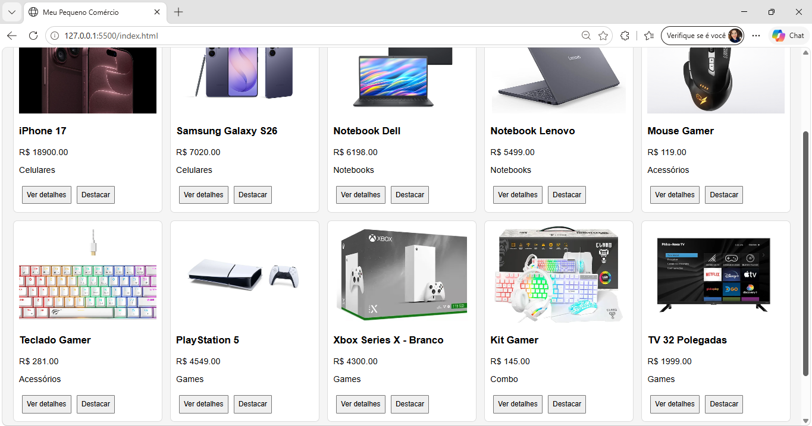
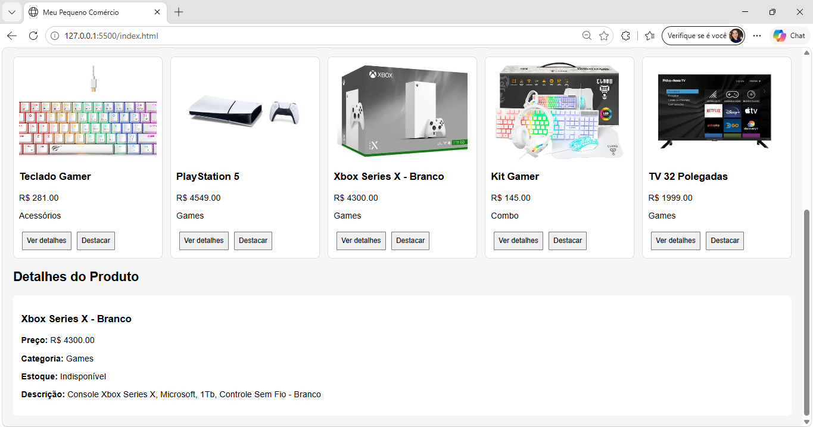
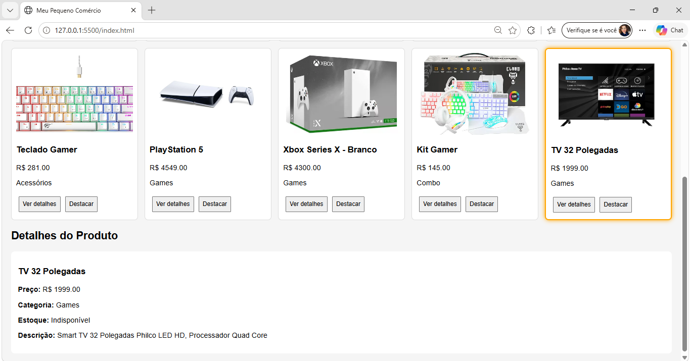
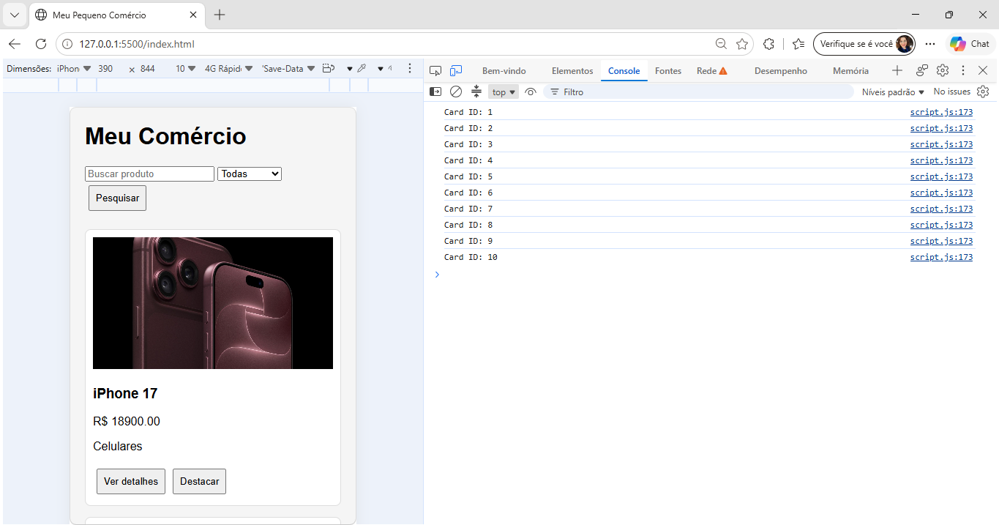
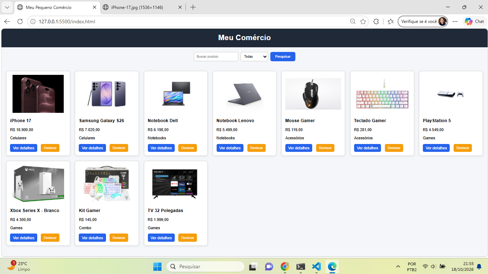
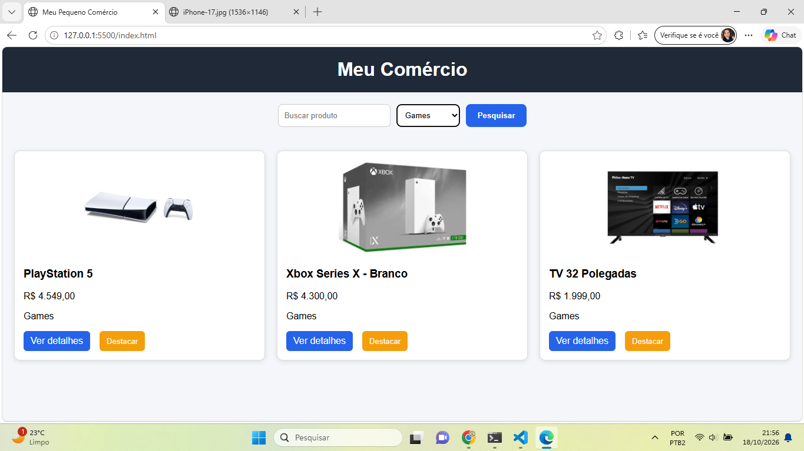
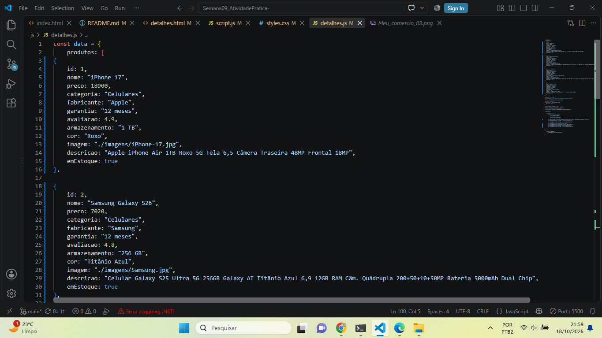

# Semana09_AtividadePratica

## Atividade Prática 09 - Funções e DOM

Nome: Michael de Oliveira Faria

Matrícula: 931634

## Catálogo renderizado

### Print 1

### Print 2

## Detalhes

### Print 3

### Print 4

## Console

### Print 5

# Semana11_AtividadePratica

## Atividade Prática 11 - Páginas de detalhes dinâmicas

Nome: Michael de Oliveira Faria

Matrícula: 931634

## Catálogo renderizado

### Print 6 - Home

### Print 7 - Pesquisa de item 

### Print 8 - Detales do produto

### Print 9 - Erro na pesquisa

### Print 10 - Dados JSON do arquivo detalhes.js.

